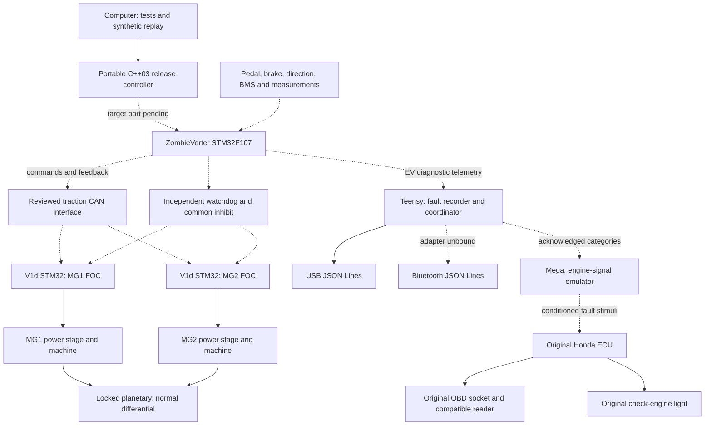

# Controller release: thermal protection and Honda fault indication

29 October 2026. **Implemented portable software; physical commissioning pending.**

The traction target is ZombieVerter STM32F107. No board-specific traction driver,
pin map or flashable ZombieVerter image is supplied: the actual board revision,
V1d CAN modification and independent inhibit circuit still need verification.
The Mega and Teensy images compile separately and have not been flashed. The portable
control objects also cross-compile for Cortex-M3 with software floating point; this
is not a linked firmware image.

The [production worksheet](../../configs/controller-release-profile.json) leaves
unknown component limits, sensor identities and port evidence empty. It is not
loaded by firmware and cannot silently enable outputs.

## Architecture

Solid arrows show logical responsibilities, not verified installed wiring.
Dashed arrows mark unfinished physical interfaces.



Each FOC processor owns its resolver and phase-current loop. The supervisor
coordinates effort and permissions; Honda detection is outside the shutdown path.

## Control behavior

| Concern | Implemented behavior | Remaining evidence |
| --- | --- | --- |
| Temperatures | Six independently configured channels: two motors, two inverter channels, oil and coolant; sensor ID/location, age, uncertainty, filtering and recovery hysteresis | Confirm available sensors, location, calibration and operating limits |
| Hard thermal limits | Raw value plus declared uncertainty triggers shutdown even while filtered temperature remains low | Sensor bandwidth and physical fault-to-inhibit measurement |
| Allocation | Local heating reduces its channel; oil/coolant reduce both. Existing simulated current envelopes remain; no torque calibration is implied | Measured command/torque/current maps |
| Missing measurements | Required missing/stale/regressing samples inhibit; optional unavailable samples create advisory records. Loss of a previously hot optional channel cannot remove protection | Required-channel decision and acquisition rates |
| Circulation | Both signed DC-power lower bounds must exceed threshold, oppose each other, be fresh and aligned, and persist continuously | Independent channel DC-current/power availability and uncertainty |
| Fault records | Fixed 64-key table with identity, component, severity, first/latest occurrence, count, value, limit and validity; overflow inhibits | Target memory/timing review |
| Dispatch | Generation-tagged local queue acceptance, completion timestamps, command age and pair skew; startup release awaits both completions | Actual CAN mailbox, cancellation and inhibit behavior |

Use `run_release`, not the historical `run`, for the revised policy. Acquisition-source
IDs must match the configured temperature sensor IDs. The release
layer disables the historical one-sample circulation trip and supplies component
derating factors to the legacy allocation policy. Both versions retain their tests.
Runtime fault bits keep their original meaning; bit 11 adds required-measurement
failure and bit 22 adds dispatch timing failure.

`demonstration_release_config()` is a teaching profile: 70/90 °C derate/stop,
5 °C recovery hysteresis, 100 ms filtering, 80 ms measurement age, 500 W opposing
power lower bound for 100 ms, 5 ms power alignment, 10 ms command period,
5 ms command age and 2 ms pair skew. These are **not component ratings**.
Thermal factors are diagnostic allocation inputs; any shutdown still inhibits both
channels. Required motor/inverter temperatures must be present even in single-motor mode.
Oil/coolant are optional only in the demonstration; the production review must decide.

The temperature filter advances only on a new acquisition timestamp. Invalid data
breaks circulation confirmation; gaps cannot count as continuous evidence.
No transient exemption disables independent overcurrent or inverter protection.
`cooling_percent` is only a derating-related demand indicator; it does not implement
a pump/fan law or establish flow. Pump control remains unbound.

## Port and diagnostics contracts

- `Releaseport` adds physical-output declaration, pair generation, per-channel TX
  completion and pending-frame cancellation to the existing hardware abstraction.
- Physical ports require a production profile and verified hardware flag. These
  flags record an external engineering release; software cannot validate the wiring.
- Poll frequently enough to observe the configured command deadline. Pending
  transmission does not release startup inhibit or refresh the runtime watchdog.
  Existing drive may remain enabled for the bounded update interval; failure
  requests common inhibition. No atomic two-inverter update is claimed.
- A local completion is not controller execution. `controller_observed` records
  additional evidence only; no generic acknowledgment is invented. The production
  port must establish actual telemetry acceptance semantics and the hardware inhibit path.
- Cancellation must cover hardware mailboxes and software queues. Every inhibit
  and cancellation failure latches; disarmed, zero-request reset requires successful
  inhibition/cancellation. No old command is replayed on recovery.
- Optional component telemetry uses IDs `0x660–0x662`, a separate ordered triplet
  with 20 ms assembly deadline, counter and CRC-16. Existing `0x650–0x652` mask
  telemetry is unchanged. These are project interfaces, not OEM/OpenInverter IDs.
- Detail fields carry identity, component, severity, active/valid flags, signed
  milli-units and sender boot milliseconds. Thermal values use °C, circulation W;
  unavailable values have validity false. Sender timestamps do not prove synchronized
  physical latency. `diagnostic_detail` supplies the conversion; CAN transmission
  and periodic full-state publication remain responsibilities of the target port.
- The gateway keeps latest component details in RAM. Coarse EV history retains the
  existing EEPROM journal. Export detailed USB records before power removal;
  durable per-component logging is not implemented.

See [Honda behavior](HONDA_ECU_AND_OBD.md), [interfaces](HONDA_HARNESS.md) and
[code dictionary](HONDA_DTC_CODES.md). No Bluetooth hardware/pins are assigned.

## Reproduce and review

```powershell
cmake --build build-capstone --config Debug
ctest --test-dir build-capstone -C Debug --output-on-failure
.venv-firmware/Scripts/python.exe -X utf8 -m platformio run -d firmware
.venv-bench/Scripts/python.exe tools/controller_revision_demo.py `
  --executable build-capstone/Debug/controller_revision_demo.exe `
  --output output/controller-revision-review
```

The replay output directory must be new. It contains CSV, JSON, Markdown, SVG and
300 dpi PNG. Replay covers monitoring; mock-port tests cover dispatch. All are
synthetic software evidence. Hardware acceptance additionally requires scope
captures, actual ECU codes/MIL behavior, a compatible reader and installed-vehicle
verification. No sustained thermal rating or physical shutdown time is claimed.

The JSF scope now includes the release header and both release implementations.
Manual rules, platform review and target timing remain open. Historical readability
token hashes intentionally describe the earlier formatting-only pass; this release
changes behavior and must not be represented as token-equivalent to that baseline.

Target object check (GCC path depends on the installed toolchain):

```powershell
.venv-bench/Scripts/python.exe tools/build_controller_target.py `
  --compiler <USER_HOME>/.platformio/packages/toolchain-gccarmnoneeabi-teensy/bin/arm-none-eabi-g++.exe `
  --output build-stm32-controller
```

The output manifest pins compiler, flags, sources and object hashes. No startup code,
linker script, interrupt handlers or physical port is included. Implementers must not
flash these objects or infer a schedulability guarantee from successful compilation.

Current formatting check (does not compare against historical behavior):

```powershell
python tools/check_readability.py --format-only `
  --clang-format 'C:/Program Files/LLVM/bin/clang-format.exe' `
  --black-python .venv-style/Scripts/python.exe `
  --report docs/capstone/evidence/controller-release-readability.json
```

## Review results

| Check | Result |
| --- | --- |
| MSVC complete regression | 8/8 suites passed; 147 new release assertions |
| Clang control regression | 2/2 suites passed |
| STM32F107 object compilation | 5 implementations, Cortex-M3 soft-float; no linked image |
| Firmware | Mega, default Teensy and isolated legacy demonstration built |
| JSF automated review | 40 rules; 0 violations, suppressions or coverage warnings |
| Manual JSF review | 193 items remain; compliance not established |
| Readability | Current formatting passed; behavior intentionally differs from old baseline |

[Evidence manifest](evidence/controller-release-review.json) pins source and binary
hashes. [Validation](VALIDATION.md) distinguishes these results from physical work.
The replay report (generated locally; not published) includes presentation
figures and teaching settings; CSV/JSON are alongside it. The waveform spike and
circulation timing are synthetic inputs, not vehicle measurements.
