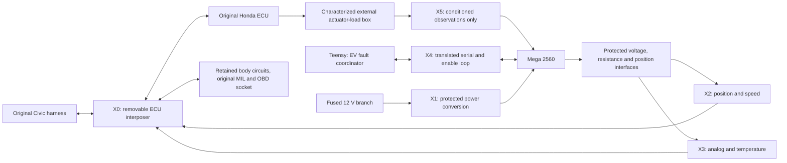
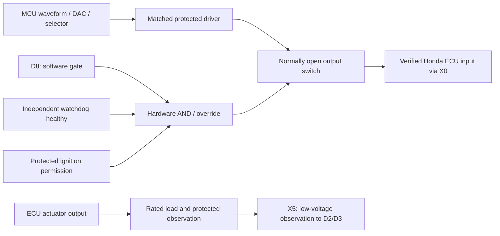
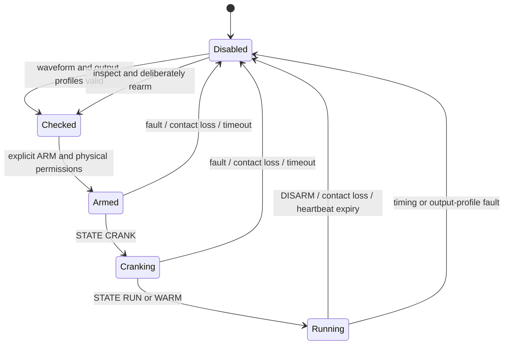

# Engine-signal simulator: wiring and first demonstration

29 October 2026. **Project connector design; Honda ECU cavities are not released.**
Vehicle: 1996 Civic DX hatchback, manual, Federal/non-California per owner.
The exact `37820-…` ECU number and matching factory diagram remain required.
The numbered X connectors below are new project connectors, **not Honda pin numbers**.

## What connects to what



Use X0 to divert selected ECU inputs to the simulator while passing retained circuits
through unchanged. Do not connect a simulator and real sensor to the same input.
No Mega/Teensy GPIO connects directly to a Honda wire. The load box is separate from
the low-current sensor enclosure; its ECU-side connectors and loads await identification.

## Connectors to prepare

Use these standard mating housings as the project baseline. For X1, put the recessed
socket-contact half on the live vehicle supply lead. Label every half with X number.
X2 uses key A; X3 key B to prevent mixing the two 12-way signal connectors.

| ID | Purpose | Mating housings | Wedgelocks | Quantity |
| --- | --- | --- | --- | --- |
| X0 | ECU interposer | ECU-mating and original-harness-mating set; exact parts pending ECU identity | Matching OEM locks | 1 complete pass-through assembly |
| X1 | Power | DT06-4S / DT04-4P | W4S / W4P | 1 pair |
| X2 | Position/speed | DTM06-12SA / DTM04-12PA | WM-12S / WM-12P | 1 pair |
| X3 | Analog/temperature | DTM06-12SB / DTM04-12PB | WM-12S / WM-12P | 1 pair |
| X4 | Coordinator/enable | DTM06-6S / DTM04-6P | WM-6S / WM-6P | 1 pair |
| X5 | Protected load observations | DTM06-4S / DTM04-4P | WM-4S / WM-4P | 1 pair |

Part families and matching locks are listed in the
[TE connector selector](https://www.te.com/content/dam/te-com/custom/media/connector-selector/docs/ict-connector-selector-en.pdf).
Buy the exact size-16 DT and size-20 DTM contacts for the selected wire gauge,
plating, seal range and current duty. Contact part numbers, fuse rating and wire
sizes remain selection items; housing choice alone does not rate the complete circuit.

Editable files: [connector worksheet](../../configs/emulator-harness-connectors.json),
[CSV netlist](emulator-harness-netlist.csv), and standalone Mermaid sources for
[topology](diagrams/engine-install-topology.mmd),
[conditioning](diagrams/engine-interface-gating.mmd) and
[states](diagrams/engine-simulator-states.mmd).

For the default populated cavities, allow **28 DTM pin contacts + 28 sockets**, **3 DT
pins + 3 sockets**, twelve DTM unused-cavity seals and two DT seals, plus spares.
X2-7/8 stay sealed until a fourth position channel is verified; fitting it adds
two DTM pins/two sockets and replaces four cavity seals.
Counts provision both oxygen-signal channels; adjust population if the verified ECU
does not use one. Terminal/seal quantities are connector provisions, not ECU fitment proof.
Include the correct crimper, extraction tool, strain relief, loom, grommets and labels.
These are additions/details within the existing harness allowance, not a second budget.

Read the molded cavity numbers and manufacturer face drawing. Mating-face and
wire-entry views mirror each other; the tables are electrical netlists, not face drawings.
Never select an OEM ECU connector from “1996” or “OBD2A” alone.

## X1 — power

| Cavity | Net | Connection |
| --- | --- | --- |
| 1 | Protected battery +12 V | Separate fused electronics branch → reverse-polarity/transient protection → regulated logic supply |
| 2 | Ignition +12 V | Protected hardware regulator/output-enable circuit; no MCU pin assigned |
| 3 | Electronics power return | Reviewed low-voltage ground point; not an injector/heater current return |
| 4 | Unused | Seal both halves |

Use a protected regulator that supplies the Mega's required rail through its approved
power arrangement. Check USB/external-supply backfeed. Size the fuse from converter
inrush, load and wire protection; no fuse value is released yet. Retain ECU keep-alive,
ignition, grounds and necessary relay functions through the original protected circuits.
Do not power the MCU from the ECU's sensor-reference output.
Ignition removal must open the output gate in hardware. Retained ECU keep-alive
power is separate from emulator running permission.

## X2 — conditioned position and speed

| Cavity | Net | Mega source, before conditioning |
| --- | --- | --- |
| 1 / 2 | CKP signal + / − | D22 → matched position driver |
| 3 / 4 | TDC signal + / − | D23 → matched position driver |
| 5 / 6 | CYP signal + / − | D24 → matched position driver |
| 7 / 8 | Reserved additional position + / − | Seal by default; D25 inactive in supplied three-channel pattern |
| 9 / 10 | VSS signal / verified VSS return | D26 → matched speed-output driver |
| 11 / 12 | Unused | Seal both halves |

The paired position allocation accommodates a differential interface; it does not
establish Honda sensor polarity or type. If the verified circuit uses another topology,
revise the netlist explicitly. Do not ground an assumed VR negative wire. Preserve
pairing/shield treatment from the matching diagram and driver design. The stock
cluster/ECU VSS distribution needs a verified buffer and pulses-per-distance calibration.
Virtual engine RPM is separate from actual EV road speed.
Do not use synthesized Honda VSS as traction feedback. Emulator loss must not be
interpreted as proof that the vehicle is stopped; retain independent valid EV speed data.

## X3 — conditioned voltage and resistance signals

| Cavity | Net | Internal source / disconnect |
| --- | --- | --- |
| 1 / 2 | TPS signal / TPS reference return | DAC0 / D34 |
| 3 / 4 | MAP signal / MAP reference return | DAC1 / D35 |
| 5 / 6 | Upstream O2 signal / its reference return | DAC2 / D36 |
| 7 / 8 | Downstream O2 signal / its reference return, if fitted | DAC3 / D37 |
| 9 / 10 | ECT signal / ECT reference return | External resistance ladder selected by D42–44; connect D38 |
| 11 / 12 | IAT signal / IAT reference return | External resistance ladder selected by D45–47; connect D39 |

Each return goes to its verified ECU circuit reference. Repeated return terminals
do not authorize shorting distinct sensor grounds, power ground or shields together.
The output interfaces must be referenced appropriately without carrying load current.

Four dual SPI DACs use MOSI D51, SCK D52 and chip-select D30–33. Only voltage
channels 0–3 are fitted in the supplied profile. DAC4/5 are **not** the ECT/IAT source;
those circuits require passive resistance emulation. Channels 6/7 remain unassigned.
Do not connect the unused DACs or pins D40/41 to guessed Honda functions.

The output profile defines normal ranges, diagnostic low/high voltages, DAC reference
and ladder selections. Bench O2 commands are capped at 1 V; that is a teaching choice,
not a verified Honda sensor specification. LOW/HIGH for ECT/IAT selects calibrated
fault indices, not a direct GPIO voltage and not necessarily “cold/hot.” Production
needs measured ladder ohms and the actual ECU transfer curves.
The DAC conversion follows the [MCP4922 unity-gain transfer function](https://ww1.microchip.com/downloads/aemDocuments/documents/OTH/ProductDocuments/DataSheets/22250A.pdf):
`code = min(4095, floor(request_mV × 4096 / reference_mV))`. Reference error,
output swing and external buffering still require calibration.

## X4 and X5 — logic interfaces

| Connector/cavity | Net | MCU connection |
| --- | --- | --- |
| X4-1 | Mega transmit → coordinator | Mega TX18 → protected level translator → Teensy RX7; 3.3 V at coordinator end |
| X4-2 | Coordinator transmit → Mega | Teensy TX8 → translator → Mega RX19 |
| X4-3 | Inter-board logic return | Reviewed logic-ground connection |
| X4-4 | Emulator enable contact | Protected dry-contact input to Mega D9; LOW enables only an already armed emulator |
| X4-5 | Enable-contact return | Dry contact closes X4-4 to this return; not a traction enable command |
| X4-6 | Unused | Seal |
| X5-1 | Conditioned injector observation | Load-box protected logic output → Mega D2 |
| X5-2 | Conditioned oxygen-heater observation | Load-box protected logic output → Mega D3 |
| X5-3 | Observation logic return | Reviewed logic return |
| X5-4 | Unused | Seal |

X5 carries only conditioned MCU-compatible logic. Injector, ignition, heater and
idle-air power wires do not enter it. Their dummy loads need a separate rated harness,
thermal design and the original output-driver specification. A logic observation
does not replace a monitored load. For long inter-board runs, replace local UART wiring
with a reviewed differential physical layer; do not extend bare TTL through the car.
The Teensy enclosure needs its own protected regulated power connection; X4 supplies
no power. Its 3.3 V logic pins must not receive the Mega's 5 V signals directly.

Local service header: D10-to-ground bench jumper, physically absent from the vehicle
harness. USB uses the board USB connector. D11 drives the independent watchdog;
D8 is the active-high global output gate. Both stay inside the protected enclosure.



“Open” requires the external switch and global gate to disconnect the complete
interface, including emulator-side pullups that could backfeed the ECU. Pulling a GPIO LOW
alone does not prove a disconnected circuit. Watchdog power loss must also open it.

## Patching the Civic harness

1. Record the complete ECU label and obtain its factory electrical/connector diagrams.
   Photograph connector faces, locks and numbering; populate the [Honda worksheet](../../configs/honda-ecu-interface.json).
2. Build X0 as a removable interposer. With power disconnected, verify every
   pass-through and intercepted circuit by continuity; preserve required body functions.
3. Divert each selected **ECU input** to X2/X3. Isolate its former sensor-side signal
   conductor(s) inside the adapter. Retain any shared reference returns needed elsewhere.
   Leave genuine retained sensors connected through their original circuits.
4. Connect the characterized actuator-load box only to the verified ECU **outputs**;
   bring its protected observation signals to X5. Do not drive an ECU output from a DAC.
5. Retain original MIL and OBD wiring directly to Honda. Do not splice Teensy CAN into
   the diagnostic socket or add a lamp driver. Keep fuel/ignition hardware isolated;
   trace necessary main-relay supplies before removing any fuel-pump/engine branch.
6. Fit X1/X4, protection, labeling and strain relief. Keep signal circuits away from HV,
   phase cables and dummy-load currents. EV cooling/brake assist remain independently controlled.
7. First test with the ECU unplugged: verify voltages, impedance, polarity, ground
   offsets and watchdog/reset/open states. Connect Honda only after its profile is released.

## Firmware and demonstration

Build `mega_engine` using [firmware instructions](../../firmware/README.md).
`emulator_pins.h` is the board pin authority. `output_profile()` holds electrical
limits; the supplied vehicle profile remains disabled. No factory pin map is inferred.

For an isolated instrument fixture, use the local bench jumper and enable contact.
Send ARM BENCH, STATE CRANK, then STATE RUN/RPM as appropriate. Keep PING within
100 ms intervals; use STATUS to read armed/I/O-fault/profile state. If coordinator
CAT messages have started, they must also continue; PING cannot bypass their timeout.
Use DISARM before reconnecting anything. USB commands select scenarios; timer ISRs
produce position pulses. Parsing now runs outside interrupt exclusion.
Use a timed serial client for standalone heartbeat tests, not hand-typed PINGs.
The supplied coordinator already sends periodic PING/CAT; with missing EV telemetry
it intentionally requests the communication category instead of reporting a healthy car.
Sensor arithmetic and VSS division also run outside interrupt exclusion; only
small input snapshots and state writes use atomic sections.



Output selection runs every 20 ms. Temperature ladder changes open that channel
before changing its selector; steady voltage updates do not interrupt position gates.
An invalid output profile/range disables all outputs and reports emulator failure.
Measure actual edge jitter, selector transients and reset behavior; compilation and
host tests do not establish these timings. I/O faults require correction and reset.

For each real ECU category, record scope capture, electrical condition, pending/stored
Honda code, MIL behavior, detection delay and recovery. Test simultaneous categories.
Channels 6/7 are unfitted, so their default board mappings report unavailable. Extra
distinct categories require identified interfaces; eight project labels do not prove
eight usable Honda codes. Full engine-monitor operation remains an ECU test objective.

## Software verification

All ten CTest suites passed, including 70 new interface checks. Mega and Teensy
images compile; neither was flashed. Current formatting checks passed. Tests cover
DAC conversion/ranges, ECT/IAT fault selection, unfitted channels, disarming,
prepared-command behavior and reproducible connector/diagram exports.
Raw logs and hashes are indexed in [the review record](evidence/emulator-harness-review.json).
These results do not establish Honda fitment, electrical performance or reader codes.

```powershell
cmake --build build-capstone --config Debug
ctest --test-dir build-capstone -C Debug --output-on-failure
.venv-firmware/Scripts/python.exe -X utf8 -m platformio run -d firmware
python tools/export_emulator_harness.py --check
```

After changing the project netlist or Mermaid blocks, run the export tool without
`--check`, then review the resulting CSV and `.mmd` files.
