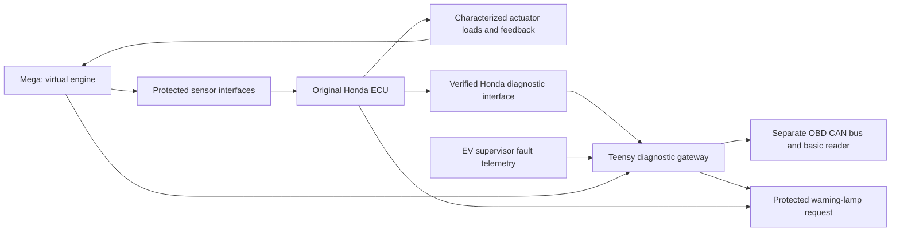

> Historical architecture, superseded 29 October 2026. Do not use as the vehicle wiring specification.

# Original Honda ECU, engine simulation and EV fault codes

**First software review | 28 October 2026 | Hardware acceptance pending.**

## What the system does

The **Mega 2560** generates engine-signal scenarios for the original manual-DX
Honda ECU. The **Teensy 4.1** combines Honda trouble codes and actual EV fault
records behind one CAN OBD-II endpoint. This allows a basic reader to display
both without changing protocols or manually selecting two controllers.

The gateway does not forward reader commands into the EV control bus. It cannot
authorize torque, clear a traction latch or replace the independent drive inhibit.
The original Honda diagnostic connection remains accessible for direct comparison.

## Implementation and current limits

| Function | Delivered | Physical evidence still required |
| --- | --- | --- |
| Engine positions | Fixed-memory 720-degree edge scheduler, wrap handling, dropped-channel injection and missed-edge disarm | Exact required pickup channels, pattern, phase, polarity, amplitude and timing |
| Engine scenarios | Stopped/cranking/running/warm-up; bounded serial controls and heartbeat | Validated starting, acceleration and monitor behavior on the actual ECU |
| Analog/resistive signals | Eight DAC command channels, disconnect commands and two resistance-ladder selectors | Sensor curves, impedance, reference/ground and real interface calibration |
| Actuator feedback | Protected-input injector-pulse capture and heater state affect a teaching mixture model | ECU load monitoring, input polarity and calibrated engine/catalyst dynamics |
| Honda diagnostics | Nonblocking 5-baud initialization/UART polling template; checksum and reply validation; stored/pending reconciliation | Exact ECU protocol, headers, keywords, echo, timing and complete response behavior |
| EV diagnostics | All existing C supervisor and C++ runtime fault bits mapped; optional MG1/MG2 source flags | Actual publisher, verified network configuration and source measurements |
| Reader endpoint | CAN discovery/status, stored/pending lists, local history clear and ISO-TP responses | Compatibility with the selected inexpensive reader |
| History | Source/context records and CRC-protected two-slot persistence | Board power-cut/write-endurance tests |
| Warning lamp | Combined software request and protected hardware concept | Actual lamp circuit, electrical OR, watchdog and failure-warning tests |

**Full engine emulation is not yet established.** An ECU accepting position pulses
does not prove that oxygen, misfire, EVAP or actuator monitors behave normally.
The default pattern, sensor values and injector-response model are explicitly
synthetic. Vehicle output arming is rejected by the supplied profile.

The earlier automatic-transmission sketch remains archived reference material.
Its speed scaling, shaft signals and range-switch logic do not describe this
manual-DX engine task. No automatic-transmission DTC suppression is introduced.

## How the original electronics are retained

The user reports non-California/Federal equipment; exact ECU identity is pending.
Identify the complete ECU label (`37820-...`), engine/harness variant, emissions
market and matching Honda factory diagrams. Then inventory ECU inputs and outputs
using [the harness schedule](legacy-honda_harness.md). Retain required ignition power,
keep-alive supply, grounds, diagnostic access and body functions through a removable
breakout. Do not identify a connector cavity from wire color alone.

Position signals must match their electrical source: an open-drain pulse, voltage
waveform and differential variable-reluctance pickup are different interfaces.
Thermistors generally require a controlled resistance; driving a DAC into an
unknown ECU pull-up does not reproduce the sensor's electrical behavior.

Engine removal also removes electrical loads and control responses. A software
signal cannot satisfy an ECU output's current diagnostic unless the required
electrical behavior is present. Injector, ignition, oxygen-heater, idle-air,
purge and other applicable circuits therefore need individual assessment.
Loads require rated fixtures, heat rejection and protected observation inputs.
Fuel and ignition actuators are not connected as uncontrolled live test loads.

Verify fan, A/C, alternator/ELD and main-relay relationships before deciding which
original functions remain under Honda control. EV cooling and brake assist must
continue independently of the simulation PC or Honda virtual-engine state.

## Fault codes and warning behavior

The gateway uses **project-defined P1Fxx codes**, not assigned Honda meanings.
The ECU's original codes are preserved. Read the numeric code against the
[project dictionary](legacy-honda_dtc_codes.md); a reader may display an unrelated
manufacturer description. A numeric collision retains separate USB source records
but cannot be distinguished by a generic code-only reader; resolve such a collision
in the project dictionary before reader acceptance.

- EV faults enter pending state immediately and become stored after 500 ms of
  repeated assertion. This is a project policy, not an OEM emissions trip rule.
- Honda stored codes are stored immediately. Honda pending codes are not promoted
  merely because the gateway repeatedly sees them.
- The warning request is conservative: active or retained stored faults, the
  Honda lamp request, or monitored interface failure can request a warning.
- Loss of EV telemetry over 250 ms, emulator status over 500 ms, or complete Honda
  status/stored/pending polling over 2 s produces a specific unavailable code.
- Power-cycle history includes source, first/last observation in boot-relative
  milliseconds, occurrence count and valid context fields. These are not wall-clock
  timestamps. Persisted active assertions become retained history on restart;
  communication health must be re-established.
- History writes are limited to one new snapshot per five seconds and committed
  incrementally. Recent events can be lost on power failure. Two CRC-protected
  slots detect incomplete records; host byte-write interruption tests do not
  prove atomicity of the Teensy's underlying flash erase/repacking behavior.
  Physical power-cut and wear tests remain required. The shared table holds 64
  source/code records; excess records raise a capacity fault. Honda polling is
  bounded to 24 unique codes per stored/pending response collection.
- Local history clear requires parked/disarmed evidence. Active faults remain;
  original Honda history is not erased by the gateway. No command resets drive
  inhibition. Stored faults can keep the lamp on until serviced and cleared.

Mode 01 advertises only PID 01 (MIL/count). Modes 03/07 provide stored/pending
codes. Mode 04 clears eligible local history. Unsupported services are not
advertised; functional unsupported requests remain silent. The gateway reports
no supported combustion readiness monitors; that is **not a passed Honda emissions
monitor claim**. Detailed EV context is available through USB, not invented
standard gasoline live-data PIDs. Permanent codes, VIN and generic freeze-frame
services are outside this version.

## Reader and electrical hardware

Use **ANCEL AD310 as the purchasing/test candidate**, with $25–$50 reserved as
an allowance, not a checked sale price. Its manufacturer lists CAN and code
reading/clearing; compatibility with this custom endpoint remains untested.
[Manufacturer reader information](https://www.anceltech.com/article/ancel-ad310.html).

Teensy 4.1 provides multiple CAN controllers but still needs physical transceivers;
its GPIO is 3.3 V and not 5 V tolerant. The Mega also needs external analog and
automotive interfaces. [Teensy manufacturer](https://www.pjrc.com/store/teensy41.html),
[Arduino Mega documentation](https://docs.arduino.cc/hardware/mega-2560/).

Use an appropriate CAN transceiver on each bus and a protected K-line interface
for the verified Honda protocol. An L9637-class device implements ISO 9141 physical
functions; it does not itself implement Honda diagnostics or make its logic side
safe for direct Teensy connection. [ST interface datasheet](https://www.st.com/resource/en/datasheet/l9637.pdf).

The [ELM327 documentation](https://www.elmelectronics.com/wp-content/uploads/2016/07/ELM327DS.pdf)
is a useful development reference for protocol selection and inspecting CAN
diagnostic exchanges. Final timing/framing acceptance follows the applicable
protocol specifications and actual reader/ECU captures.

## Staged demonstration and evidence

1. Build both board targets and run the host tests using [firmware instructions](legacy-firmware-readme.md).
2. On an isolated scope fixture, record edge counts, phase, amplitude, analog values,
   disconnect behavior and jitter under maximum UART traffic. Capture reset,
   missed-deadline, heartbeat loss, brownout and external-watchdog responses.
3. Identify the Honda ECU and qualify the conditioning/load hardware before any
   harness patch. Record ECU live data and induced DTCs for each verified input.
4. With the basic reader, show a Honda fault and distinct EV faults together,
   including more than two codes to exercise multi-frame transfer. Compare raw
   exchanges with the direct Honda reader connection. Demonstrate communication
   loss, power-cycle retention and refusal to clear while armed/moving.
5. Install only after connector, ground/reference, body-function and fault-warning
   checks pass. Record all remaining engine codes and incomplete monitors.

For the presentation, use three clearly separated evidence categories: host
software tests, measured electrical/ECU tests and installed-vehicle tests. The
current delivery supplies the first category and procedures for the others.

The generated compiled-core example report (generated locally; not published)
includes a labeled waveform figure and combined-code payload. It is deliberately
synthetic, including the injected Honda-source code.

## Preliminary BOM and cost

USD engineering allowances, not supplier quotes; quantities are per system.

| ID | Item | Quantity | Line allowance |
| --- | --- | --- | --- |
| H1 | Arduino Mega 2560 board | 1 board | $35–$55 |
| H2 | Teensy 4.1 board | 1 board | $30–$45 |
| H3 | Dual SPI DAC/reference provision | 4 channel-pair | $32–$60 |
| H4 | Analog buffers, clamps and disconnect switches | 1 lot | $35–$80 |
| H5 | 8-position resistance ladder and protected switching | 2 sensor circuit | $40–$80 |
| H6 | Position-signal conditioning/driver allowance | 4 channel | $60–$120 |
| H7 | Protected ECU output/switch observation inputs | 1 lot | $40–$90 |
| H8 | 3.3 V-compatible CAN transceiver assemblies | 2 bus interface | $30–$60 |
| H9 | K-line, optional L-line driver and logic translation | 1 assembly | $20–$45 |
| H10 | Protected automotive power, fusing and transient protection | 1 lot | $40–$90 |
| H11 | Independent watchdogs, gate and warning-lamp interface | 1 lot | $30–$70 |
| H12 | Honda breakout connectors and harness materials | 1 lot | $80–$180 |
| H13 | Characterized dummy-load provision and heat protection | 1 lot | $75–$250 |
| H14 | PCB/perfboard, enclosures, test points and connectors | 1 lot | $50–$150 |
| H15 | ANCEL AD310 candidate handheld reader | 1 reader | $25–$50 |
| | **Parts subtotal** | | **$622–$1,425** |
| | **With 25% contingency, rounded up** | | **$778–$1,782** |

Optional ELM-compatible development adapter: $35–$70 additional allowance.
ECU purchase if needed, labor, instruments, extensive load equipment, qualification,
tax and freight are excluded. DAC/position-driver/load costs depend on the actual
sensor and actuator electrical requirements. The breakout and load-bank allowance
is not a rated schematic or a complete procurement release.
